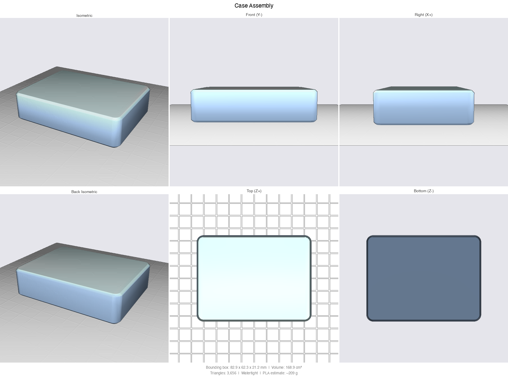

# Paragliding vario display

A handheld, portrait display for an XC Tracer Mini III GPS vario. The box is a Bluetooth LE central: it
connects to the tracer, reads its `$XCTRC` text lines (about 3 per second) and draws speed, glide ratio,
altitude, vertical speed, a Garmin-style compass dial, a wind estimate and a thermal map on a 2.7" Sharp
memory LCD (240x400 in use). It is also a BLE peripheral (`SharpDisplay`) so a laptop can set options,
replay a recorded flight into it and, in a legacy mode, draw frames. One user switch operates it.
Hardware: Adafruit Feather nRF52840 Sense, LiPo, PlatformIO with the Arduino framework.

- `NOTES.md`: measurements, findings and the open-items list.
- `PLAN.md`: the current review and improvement plan.
- `CLAUDE.md`: rules for contributors and AI agents (layering, stack limit, how to check).
- `case/`: the 3D-printed enclosure (CadQuery model, STL/STEP, previews); see `case/README.md`.

## Hardware and wiring (as built)

| Display pin | Feather pad | Arduino pin | nRF GPIO |
|---|---|---|---|
| CLK | SCK | 26 | P0.14 |
| DI (MOSI) | MO | 25 | P0.13 |
| CS (active high) | RX | 1 | P0.24 |
| EXT (EXTCOMIN) | MI | 24 | P0.15 |
| DISP, EXTMODE | not recorded | ? | ? |
| User switch | on board | 7 (`PIN_BUTTON1`) | P1.02, active low |

- Display: Adafruit SHARP Memory Display breakout, 2.7" 400x240 monochrome (product 4694), used in
  portrait. Pins are defined only in `firmware/src/pins.h`. `DISPLAY_ROTATION` is 1; 3 flips the picture
  180 degrees (to be confirmed once the box is mounted).
- Where DISP and EXTMODE are wired was never recorded. The display works, so they are presumably tied high.
- VCOM is toggled at 1 Hz on EXTCOMIN by a FreeRTOS timer.
- Only the user switch is used; the four front buttons planned earlier are not wired.
- The on-board sensors (I2C 0x1C LIS3MDL magnetometer, 0x6A LSM6DS33 accelerometer) are used for the
  magnetic compass only.

## Using it

### The switch

| Action | Result |
|---|---|
| Short press (under 0.7 s) | Flight screen: switch page. Lists and calibration: see below. |
| Hold 0.7 to 1.5 s, then release | Flight screen: open the device list. |
| Hold past 1.5 s | "Keep holding to power off" banner with a progress bar. Releasing before 3 s cancels. |
| Hold to 3 s | Powers off (System OFF). |
| Power on | Hold the switch about 1 s. A shorter tap puts the box back to sleep. |

### Flight screen

The header shows local time, the tracer battery (`XC 46%`), `SIM` while the simulator runs, and the box's
own battery. Time needs the time zone set once (`ctl.py tz`, minutes from UTC).

Both pages share the top part: a thin vertical vario strip along the left edge (instant climb filled from
the centre, a small block marks the average), and four cells: `GPS km/h`, `GLIDE`, `ALT m`, `VS m/s`. The
last line is the wind: speed, `km/h`, and the direction it comes from (for example `14 km/h E`), with
`old` when the estimate is more than 5 minutes old and `0 km/h` when there is none yet.

**Compass page** (default). A heading-up dial with the pointer at the top, N/E/S/W and NE/SE/SW/NW on the
ring, ticks every 10 degrees, and the heading as the big number in the middle. A small label above it
says where the heading comes from: `TRK` is the GPS track (used above about 4 km/h, released below 2.5),
`MAG` is the magnetic compass (used otherwise). With neither, the dial stays north-up and shows `--`.
A wind arrow sits in the corner of the dial the wind comes from and points the way it blows, relative to
the heading. It is drawn only when the heading is the GPS track and a wind estimate exists.

**Thermal page.** A heading-up map replaces the dial; you are the arrow in the centre. It shows the last
3 minutes of track in the air-mass frame (shifted by the wind drift, so a thermal holds still while you
circle). The last 90 s is solid, thicker where you climbed faster; older track is dashed. Up to 6
remembered thermals appear as rings with their average climb; a thermal is remembered after a climb of
at least 15 m with circling, drifts with the wind and expires after 15 minutes. When the newest thermal
is off the map an arrow badge at the frame edge points to it with the distance. The map has a north
marker (top-left), a wind arrow (top-right) and a scale bar. It reads `no GPS track` until there is a
track.

Wind comes from a circle fit over about the last 30 s of ground velocity while turning. It needs about
200 degrees of turn and a fitted airspeed of 14 to 72 km/h, so it appears after the first full circle.

### Status screen, `NO FIX` and `--`

- No fresh data (nothing for 3 s) replaces the flight screen with a status screen: `SEARCHING`,
  `CONNECTING`, `CONNECTED` (then "waiting for data..." and a count of good and bad lines) or `NO VARIO`,
  with the saved device name or the scan filter.
- The tracer reports latitude and longitude 0 when it has no GPS fix. Then the speed cell is titled
  `NO FIX` and speed shows 0, and the heading comes from the magnetometer.
- `--` means a value that is not a finite number or not available (glide ratio when not sinking, no
  heading, no time).

### Device list

Hold the switch for 0.7 to 1.5 s on the flight screen. Press moves the selection down (it wraps), hold
selects.

| Row | Hold does |
|---|---|
| `< back` | closes the list |
| `Calibrate compass` | starts compass calibration |
| tracer name, `-NN dBm   XX:XX` | connects to it and saves it |

Devices are sorted by signal strength. The two letters-and-digits are the last two bytes of the address,
which tells apart tracers with the same name. The list shows the active name filter and `scanning...`
while empty. The saved tracer survives power off; at boot the box reconnects to it by address (by name
only if the saved address is a private, changing one).

### Compass calibration

Start it from the device list or with `ctl.py cal start`. Turn the box slowly through every direction
(flat, on edge, inverted) until the X, Y and Z bars fill (about 70 uT of swing each). Hold the switch
(0.7 to 1.5 s) to save, short press to cancel; `ctl.py cal save` and `cal cancel` do the same. The
calibration (hard-iron sphere fit) is stored in flash separately from the saved tracer. The magnetic
heading is magnetic north; there is no declination correction.

## Build, flash, check

Setup: a Python venv at `.venv` in the repository root with PlatformIO, pyserial, bleak and pillow. In a
git worktree, link it: `ln -s <main checkout>/.venv .venv`.

    scripts/check.sh            # emulator build + all tests (sanitizers on), then the device build
    scripts/install-hooks.sh    # git pre-commit hook that runs scripts/check.sh

`check.sh` works from any directory and exits non-zero if the emulator output does not end its test run with
`0 failures` or either build fails. The hook also works in a worktree. In an emergency skip it with
`git commit --no-verify`.

Device, from `firmware/`:

    ../.venv/bin/pio run               # build

and from the repository root:

    scripts/flash.sh                   # flash over USB: checks no program holds the serial port,
                                       # retries, and only succeeds on "Device programmed."
    scripts/flash.sh feather_sense_diag   # diagnostics build: profiler (`prof`) and benchmark (`bench`) lines

Do not leave a serial monitor running while flashing: the bootloader uses the same USB port.

Serial is USB CDC at 115200 (`/dev/cu.usbmodem*`).

## Testing without the device

The emulator compiles the same `core`, `view` and `app` code on the PC with mock hardware.

    firmware/emu/build.sh              # tests, then screen renders to firmware/emu/out/*.png
    ROT=0 firmware/emu/build.sh        # renders in landscape

Run a recorded flight through the whole app (parse counts, non-finite values, wind and circling
coverage, worst tick time, frames saved to the output directory):

    python host/make_lines.py igc flight.igc --start 4185 --seconds 900 > flight.txt
    python host/make_lines.py capture host/xct_capture.log > live.txt
    firmware/emu/build.sh replay flight.txt outdir --hz 3 --inject --mix live.txt --shot-every 20

| Option | Meaning |
|---|---|
| `--hz N` | lines per virtual second (1 = real time for an IGC file, 3 = tracer rate) |
| `--inject` | deliver lines as laptop commands, like `igc_replay.py` |
| `--mix FILE` | also feed FILE through the tracer at 3 Hz (a live tracer with no fix next to a replay) |
| `--shot-every S` | save a frame every S virtual seconds (default 30) |
| `--rot R` | display rotation (default 1) |
| `--thermal` | start on the thermal page |

Replay a flight to the real box over BLE (from `host/`, without `-I`, these scripts import their folder):

    python igc_replay.py flight.igc --find                       # strongest climbs with start offsets
    python igc_replay.py flight.igc --start 4185 --speed 3 --page thermal

`--speed` is a replay speed factor (1 = real time). `--page` switches the box to `compass` or `thermal`.
While a replay feeds the box it ignores the live tracer. After the replay stops, live data returns after
3 s.

## Host tools (`host/`)

| Tool | Use |
|---|---|
| `ctl.py` | control the box: `filter 'XC*'` (scan name filter), `tz 180` (minutes from UTC), `sim on\|off` (built-in test flight), `page compass\|thermal`, `cal start\|save\|cancel` |
| `igc_replay.py` | replay an IGC file to the box as tracer lines (`--find`, `--start`, `--speed`, `--page`) |
| `make_lines.py` | convert an IGC file or a tracer capture into line files for the emulator |
| `xct_probe.py` | find the tracer over BLE, list its GATT table, log raw notifications (`[seconds] [name]`) |
| `orient_log.py` | record the compass sensor readings from the serial status line (`[seconds] [file]`) |
| `orient_analyze.py` | solve the sensor-to-case axis mapping from that log and print the code to paste (`--selftest`) |
| `wind_check.py` | run the wind estimator offline on an IGC file |
| `dashboard.py`, `send_test.py`, `bench.py`, `display_link.py` frame drawing | legacy: the early design where the laptop draws frames over BLE (`BLIT`/`DATA`/`FLUSH`). The vario screen resumes 10 s after the last draw command. Not needed for normal use. |

`display_link.py` is also the BLE connection helper that `ctl.py` and `igc_replay.py` use.

## Troubleshooting

- **"SharpDisplay not found" after stopping a replay**: the box keeps the stale laptop connection for
  several seconds. Wait about 10 s.
- **Two tracers with the same name**: tell them apart by the address id in the device list; the box
  reconnects by address. Reselect the tracer after a firmware change that alters the stored settings (the
  file is reset then).
- **The tracer accepts one connection**: disconnect phone apps first.
- **Heading is not trustworthy yet when it shows `MAG`**: the compass axis mapping
  (`toDeviceAccel` and `toDeviceMag` in `firmware/src/hw/compass_lis.cpp`) is still identity. Use
  `orient_log.py` and `orient_analyze.py` to derive it. `TRK` (GPS track) is not affected.
- **Speed unit**: the tracer's speed is assumed to be km/h; this is unverified until a capture with a
  real GPS fix.
- **Serial status line** (printed every 2 s, only when a terminal is attached):
  - `st`: `ok`/`bad` lines parsed, `fresh`, `fix`, `alt`, `spd`, `vs`, `wind=valid/speed`, `sim`, `link`
    (0 none, 1 searching, 2 connecting, 3 connected), `pg` (0 compass, 1 thermal), `marks`, `trail`, then
    timings in microseconds (`tick` worst loop pass, `refresh` panel transfer, and benchmark values).
  - `dev saved=NAME ADDR t<type> conn=ADDR`: the saved tracer and the one connected now.
  - `raw ...`: the last line received.
  - `cmp`: compass sensors (`on`, `present`, accelerometer, magnetometer, heading, source 0 none 1 GPS
    2 MAG, calibration valid).
- Saved settings (tracer, time zone, calibration) live in the nRF's flash filesystem.
