# Paragliding vario display

A handheld, portrait display for an XC Tracer Mini III GPS vario. The box is a Bluetooth LE central: it
connects to the tracer, reads its `$XCTRC` text lines (about 3 per second) and draws speed, glide ratio,
altitude, vertical speed, a Garmin-style compass dial, a wind estimate and a thermal map on a 2.7" Sharp
memory LCD (240x400 in use). It is also a BLE peripheral (`SharpDisplay`) so a laptop can set options,
replay a recorded flight into it and, in a legacy mode, draw frames. One user switch operates it.
Hardware: Adafruit Feather nRF52840 Sense, LiPo, PlatformIO with the Arduino framework.

- `NOTES.md`: measurements, findings and the open-items list.
- `PLAN.md`: the current review and improvement plan.
- `docs/MATH.md`: the maths: wind circle fit and Kalman filter, wind and temperature profile,
  thermal memory, home, tilt-compensated compass and calibration, heading smoothing, dithering.
- `CLAUDE.md`: rules for contributors and AI agents (layering, stack limit, how to check).
- `case/`: the 3D-printed enclosure (CadQuery model, STL/STEP, previews); see `case/README.md`.
  Screwless (clips and pegs only), prints without supports on a Bambu A1 in PETG; D-pad + A/B below
  the portrait screen, flat back for a velcro sticker, strap tunnel, swappable plain lid.

| Front | Back | Inside |
|---|---|---|
|  |  |  |

## Screens

Rendered by the PC emulator from the same drawing code that runs on the device (2x scale).

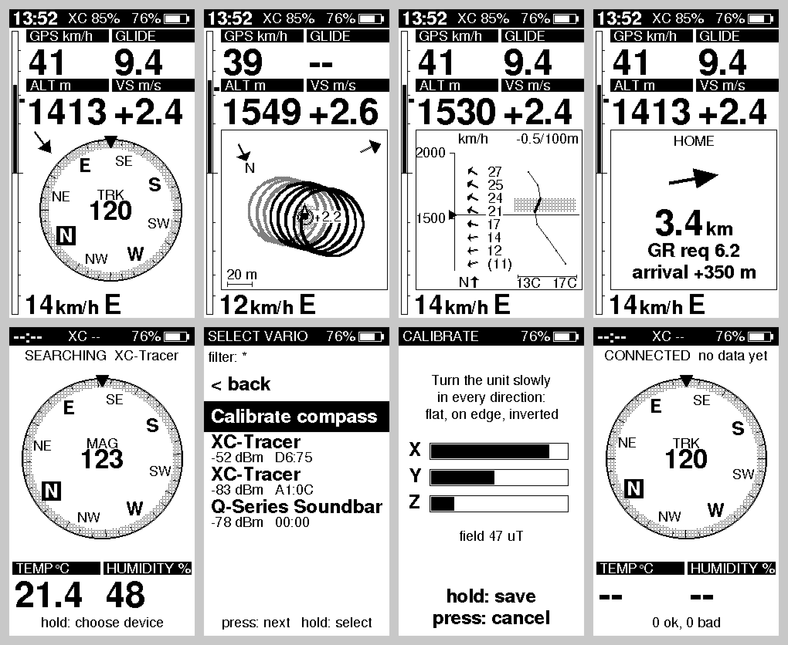

| | | | |
|---|---|---|---|
| 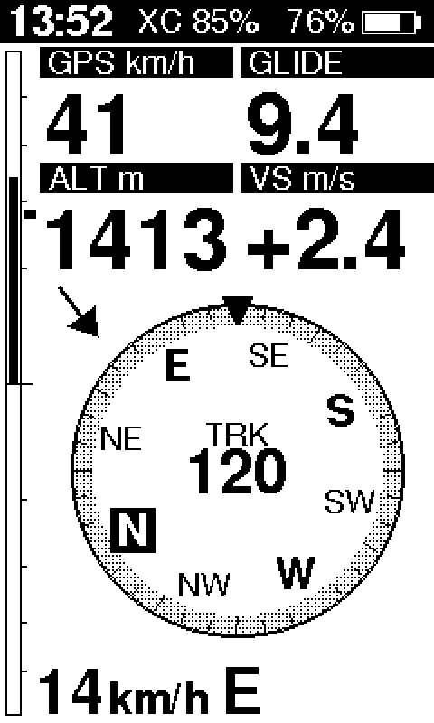 | 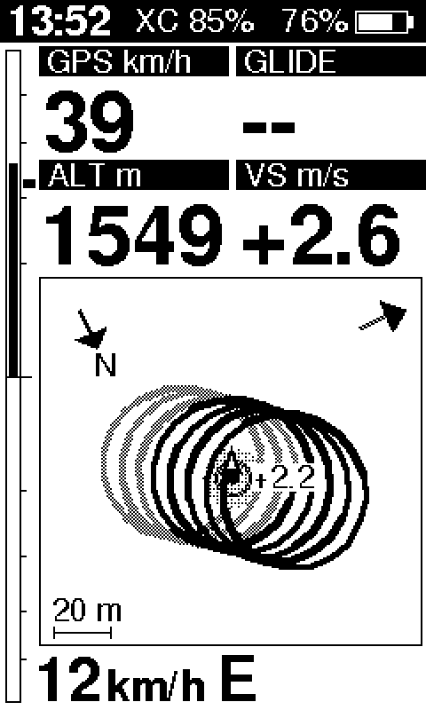 | 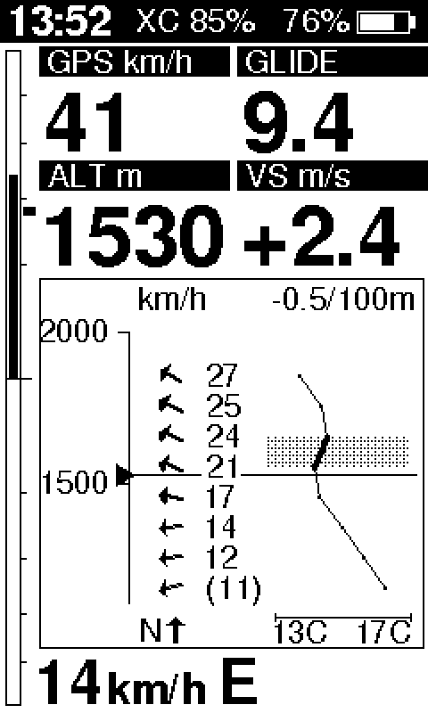 | 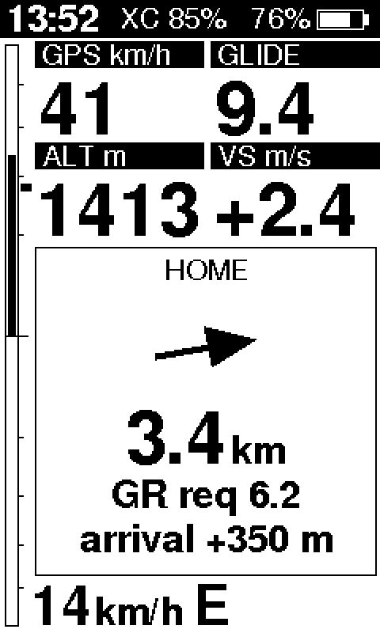 |
| **Compass**: speed, glide, altitude, climb, heading-up dial (GPS track or magnetic), wind | **Thermal**: heading-up map of the recent track in the air-mass frame, remembered thermals with their climb | **Profile**: wind and temperature by altitude, inversion band shaded | **Home**: direction and distance home, required glide ratio, arrival height |
| 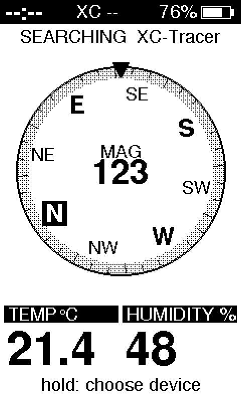 | 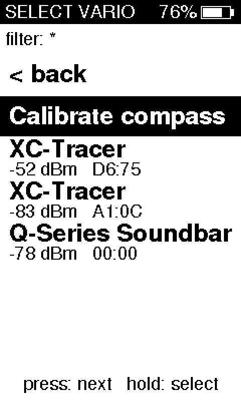 | 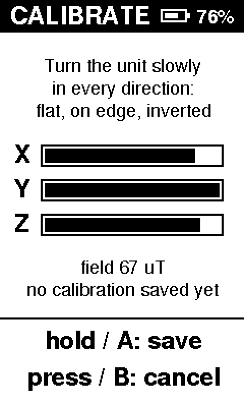 | 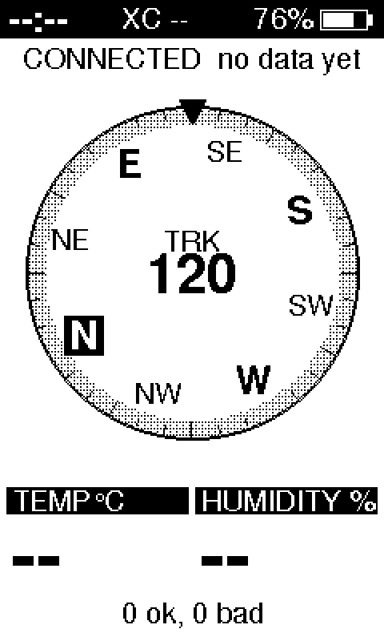 |
| **Standalone**: no tracer connected, the box is a compass with temperature and humidity | **Vario menu**: pick the tracer, sorted by signal (and Home, in the box image) | **Compass calibration**: turn the box until the bars fill (Settings app) | **Status**: connecting / waiting for data |

| 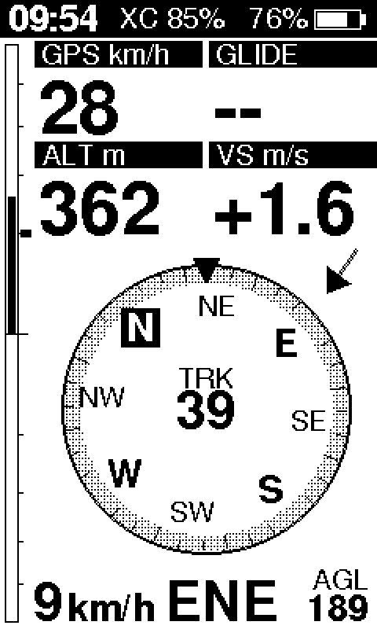 | 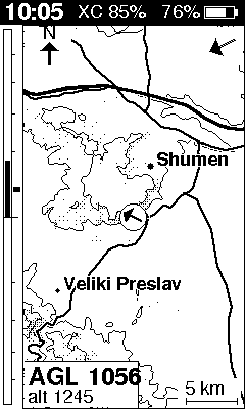 | 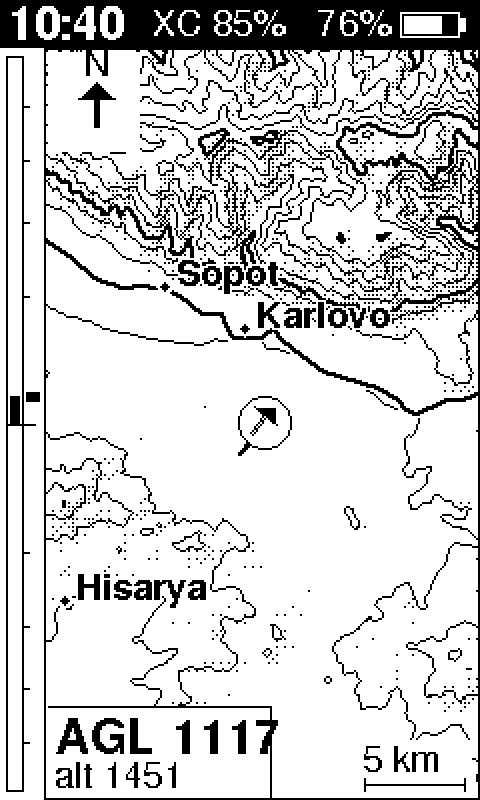 | |
|---|---|---|---|
| **AGL** (bottom right) with a map pack: GNSS altitude minus the terrain model | **Map** (after Thermal, only with a pack): north-up relief, contours, main roads, towns, track | The same over mountains (Stara Planina, test fixture) | |

**Centring page** (after Thermal): heading up, your newest turn in the middle, drawn thick where it climbed (the lift sectors; the bead is
the best of the turn), the core of the thermal as a target with a fat arrow from your circle's centre to it (its length is the distance to move the
circle), dotted rings at 25 and 50 m, the climb now as a number, a gauge (bar = turn average, diamond = best of the turn, triangle = now),
the lean of the thermal as an arrow, the trend of the lift as a glyph, and strength by height as bars on the right. No words. It needs two full turns of
circling. 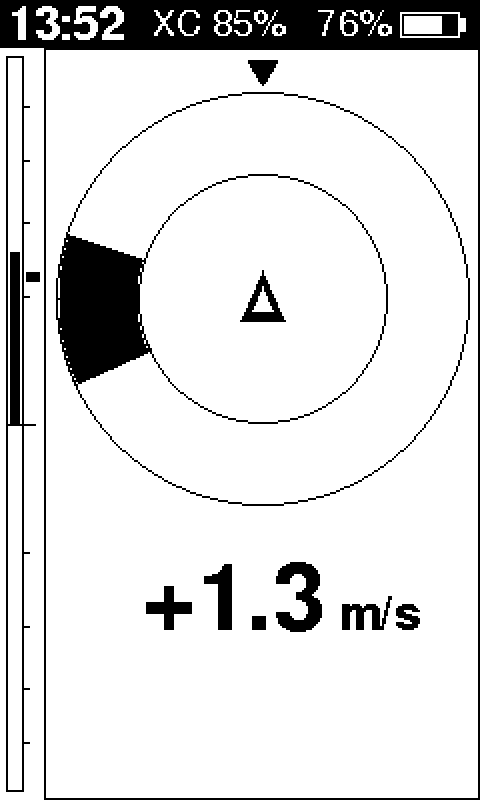 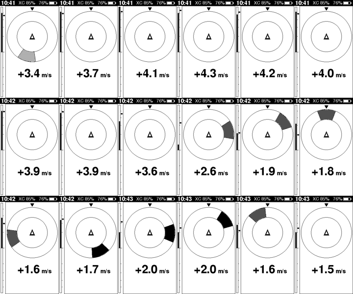

Grey tones are an 8x8 ordered dither on the 1-bit panel.

### Terrain (map pack)

With a map pack (`host/terrain/mkmappack.py`, format in `host/terrain/FORMAT.md`; Bulgaria is 1.72 MB: Copernicus GLO-90 heights
on a 200 m grid, towns and main roads from OpenStreetMap) the vario shows **AGL** (bottom right of every page; the GNSS altitude of
the tracer minus the terrain model under the fix, `--` without a fix or outside the pack) and a **map page** after the thermal page.
AGL comes from a model: typically +-10 m, up to 80 m at single peaks and gorges, and it includes trees and buildings (a surface
model). It is not the baro altitude. The map page is north-up at 100 m/px (22 x 38 km), sun-lit hillshade (sun from the south-west),
dotted contours (every 200 m, every 5th bolder), main roads (solid, no railways), towns (Latin names), the track of the last 20
minutes and the pilot arrow (a paper plane). The picture is built in small slices between loop passes, so the vario never stalls on it.
The attribution (Map (c) OpenStreetMap contributors (ODbL), Copernicus DEM (c) DLR / Airbus, provided under COPERNICUS by the EU and
ESA) is shown once per boot as a banner and always under Settings > About. Without a pack nothing changes.

**Loading the map into the box** (one command; the pack lives in the board's own 2 MB QSPI flash, so loading never touches the
firmware or the saved settings). Needs an image with the loader (`feather_sense`, `feather_sense_diag`, `feather_sense_box`), the box
connected by USB:

    .venv/bin/python host/load_pack.py bulgaria.pack          # finds the box, erases, streams, checks, restarts it
    .venv/bin/python host/load_pack.py --status               # what the box holds now (header, whole-pack CRC)

The box shows no map while it loads; the header that makes the pack valid is written last, after the box has checked the CRC of
the bytes it stored, so an interrupted load leaves "no pack", never half a pack. With a terminal attached the box prints a
`pack ...` status line (header, length, CRC check, flash id, read speed, whether the terrain code opened it).
On the PC: `firmware/emu/build.sh play box --igc f.igc --pack bulgaria.pack` (default: the study pack if present, else the Sopot test fixture);
`firmware/emu/build.sh loadtest [pack]` runs the loader script against the firmware's loader code over an in-memory flash.

## Under the hood: what we are proud of

- **A game-grade 1-bit renderer on a 64 MHz microcontroller.** `firmware/src/platform/gfx/` draws straight into
  the panel's native frame buffer in whole bytes and spans instead of Adafruit_GFX's one virtual call
  per pixel. The busiest frame (thermal map, 3 minutes of track, four big numbers) went from
  **103 ms to 5-6 ms**; a 100x20 filled rectangle from 4.6 ms to 0.08 ms. The output is tested to be
  bit-identical to the library's, in all four rotations.
- **Fast text.** Fonts are pre-rotated at boot into glyph atlases laid out in the panel's native byte
  order, so a glyph is a byte copy: "1234" in a 24 pt bold font draws in 0.33 ms instead of 2.8 ms
  (22 KB of RAM for four fonts).
- **Grey on a black-and-white screen.** 17 grey levels from an 8x8 ordered (Bayer) dither anchored to
  the screen, used for the compass ring, the older track, thermal discs and the inversion band; a host
  tool converts images into 4-bit sprites.
- **The panel transfer runs in the background.** Changed lines are packed into a second buffer and sent
  by EasyDMA on SPIM2 at 8 MHz while the next frame is drawn (SPIM3 was avoided because of the chip's
  anomaly 198). Presenting a frame costs the loop about 2.5 ms instead of up to 14 ms. Animation runs
  at 20 fps: the compass glides along the shortest arc instead of jumping.
- **Wind from circling alone.** A least-squares circle fit on ground velocity while turning gives wind
  and airspeed after one full circle, and a Kalman filter refines it in between; the thermal map is drawn in the air-mass frame, so a thermal
  stays put while you drift. See [docs/MATH.md](docs/MATH.md).
- **A compass that never goes away.** The magnetometer runs all the time with tilt compensation and a
  hard-iron sphere-fit calibration; a gyro (Mahony filter) gives the instant response and the
  magnetometer only corrects it slowly; the heading switches between GPS track and magnetic with
  hysteresis, and with no tracer at all the box is a standalone compass with temperature and humidity.
- **Everything runs on the PC too.** The same core, view and app code builds into an emulator with
  address and undefined-behaviour sanitizers: over 113,000 test checks, screen renders (the pictures
  above) and whole recorded flights replayed through the app before anything touches the device.
- **Bugs that taught us something** (all in `NOTES.md`): the core's `-Ofast` silently implied
  `-ffinite-math-only`, which deleted every NaN check on the device (the build now refuses that flag);
  parsing inside a BLE callback once hung the box (callbacks now only copy bytes into lock-free
  queues); a forgotten serial logger starved firmware uploads (`scripts/flash.sh` now refuses while
  the port is busy).

## Hardware and wiring (as built)

| Display pin | Feather pad | Arduino pin | nRF GPIO |
|---|---|---|---|
| CLK | SCK | 26 | P0.14 |
| DI (MOSI) | MO | 25 | P0.13 |
| CS (active high) | RX | 1 | P0.24 |
| EXT (EXTCOMIN) | MI | 24 | P0.15 |
| DISP, EXTMODE | not recorded | ? | ? |
| User switch | on board | 7 (`PIN_BUTTON1`) | P1.02, active low |

- Display: Adafruit SHARP Memory Display breakout, 2.7" 400x240 monochrome (product 4694), used in
  portrait. Pins are defined only in `firmware/src/platform/hw/pins.h`. `DISPLAY_ROTATION` is 1; 3 flips the picture
  180 degrees (to be confirmed once the box is mounted).
- Where DISP and EXTMODE are wired was never recorded. The display works, so they are presumably tied high.
- VCOM is toggled at 1 Hz on EXTCOMIN by a FreeRTOS timer.
- Only the user switch is used so far; the new case has six front buttons (D-pad + A/B, 6 GPIO + GND), not wired yet.
- The on-board sensors (I2C 0x1C LIS3MDL magnetometer, 0x6A LSM6DS33 accelerometer and gyro) are used for
  the compass only: the gyro gives the fast response, gravity and the horizontal magnetic field correct it.

## Using it

### The switch

| Action | Result |
|---|---|
| Short press (under 0.7 s) | Flight screen: switch page. Lists and calibration: see below. |
| Hold 0.7 to 1.5 s, then release | Flight screen: open the device list. |
| Hold past 1.5 s | "Keep holding to power off" banner with a progress bar. Releasing before 3 s cancels. |
| Hold to 3 s | Powers off. Vario-only image: System OFF. Box image: the **clock sleep** (default) or System OFF, see below. |
| Power on (System OFF) | Hold the switch about 1 s. A shorter tap puts the box back to sleep. |
| Wake (clock sleep) | Hold the switch about 1 s. A shorter press only refreshes the clock. |

**Clock sleep** (box image, Settings > Power off = Clock, the default): the box stops the tracer link, the laptop link, the
compass sensors and the map flash, and shows only the local time (HH:MM, big) and the battery on the panel, redrawn once
a minute. The time is the tracer's GPS time carried on by the box's own clock; with no GPS time yet, or none for 12 h,
it shows `--:--` (never a guess). Holding the switch for 1 s wakes the box without a reset into the start-up app,
which restarts its tracer link and sensors as after a power-on; the clock stays valid across the sleep. When the battery is
nearly empty the sleep falls into System OFF. Settings > Power off = Off gives the old behaviour (System OFF: nothing
runs, the clock is lost). The sleep current is not measured yet (see NOTES.md).

### Flight screen

The header shows local time, the tracer battery (`XC 46%`), `SIM` while the simulator runs, and the box's
own battery. Time needs the time zone set once (`ctl.py tz`, minutes from UTC).

Both pages share the top part: a thin vertical vario strip along the left edge (instant climb filled from
the centre, a small block marks the average), and four cells: `GPS km/h`, `GLIDE`, `ALT m`, `VS m/s`. The
last line is the wind: speed, `km/h`, and the direction it comes from (for example `14 km/h E`), with
`old` when the estimate is more than 5 minutes old and `0 km/h` when there is none yet.

**Compass page** (default). A heading-up dial with the pointer at the top, N/E/S/W and NE/SE/SW/NW on the
ring, ticks every 10 degrees, and the heading as the big number in the middle. A small label above it
says where the heading comes from: `TRK` is the GPS track (used above about 4 km/h, released below 2.5),
`MAG` is the magnetic compass (used otherwise). With neither, the dial stays north-up and shows `--`.
A wind arrow sits in the corner of the dial the wind comes from and points the way it blows, relative to
the heading. It is drawn only when the heading is the GPS track and a wind estimate exists.

**Thermal page.** A heading-up map replaces the dial; you are the arrow in the centre. It shows the last
3 minutes of track in the air-mass frame (shifted by the wind drift, so a thermal holds still while you
circle). The last 90 s is solid, thicker where you climbed faster; older track is dashed. Up to 6
remembered thermals appear as rings with their average climb; a thermal is remembered after at least 8
points of 0.5 m/s or more adding up to 15 m of climb (the circling part sets its centre), drifts with the wind and expires after 15 minutes. When the newest thermal
is off the map an arrow badge at the frame edge points to it with the distance. The map has a north
marker (top-left), a wind arrow (top-right) and a scale bar. The map moves continuously between the tracer's
samples (shown about 0.4 s behind the newest one, interpolated, never extrapolated), and the zoom glides
between its fixed steps. It reads `no GPS track` until there is a
track.

Wind comes from a circle fit over about the last 30 s of ground velocity while turning. It needs about
200 degrees of turn and a fitted airspeed of 14 to 72 km/h, so it appears after the first full circle.

### Status screen, `NO FIX` and `--`

- No fresh data (nothing for 3 s) replaces the flight screen with a status screen: `SEARCHING`,
  `CONNECTING`, `CONNECTED` (then "waiting for data..." and a count of good and bad lines) or `NO VARIO`,
  with the saved device name or the scan filter.
- The tracer reports latitude and longitude 0 when it has no GPS fix. Then the speed cell is titled
  `NO FIX` and speed shows 0, and the heading comes from the magnetometer.
- `--` means a value that is not a finite number or not available (glide ratio when not sinking, no
  heading, no time).

### Vario menu

Hold the switch for 0.7 to 1.5 s on the flight screen. Press moves the selection down (it wraps), hold
selects. The menu holds only flying things.

| Row | Hold does |
|---|---|
| `< back` | closes the menu |
| `Home` | box image only: leaves the vario for the home screen (see "Box" below) |
| tracer name, `-NN dBm   XX:XX` | connects to it and saves it |

Devices are sorted by signal strength. The two letters-and-digits are the last two bytes of the address,
which tells apart tracers with the same name. The menu shows the active name filter and `scanning...`
while empty. The saved tracer survives power off; at boot the box reconnects to it by address (by name
only if the saved address is a private, changing one).

### Compass calibration

Calibration belongs to the box, not to the vario: in the box image it is the first row of the **Settings** app
(home screen, Settings, Compass). The vario-only image has no on-device row for it (it is a flight instrument, the
calibration is done once at the desk); there `ctl.py cal start` starts it, and the same works in the box image while the
vario runs. Turn the box slowly through every direction (flat, on edge, inverted) until the X, Y and Z bars fill (about
70 uT of swing each). Hold the switch (0.7 to 1.5 s) or press A to save, short press or B to cancel; `ctl.py cal save` and
`cal cancel` do the same. The calibration (hard-iron sphere fit) is stored in the box's flash store
(`platform/settings/box_settings.h`), next to the time zone and the board mounting index; the vario and the compass
tool read it when they start. The magnetic heading is magnetic north; there is no declination correction.

## Build, flash, check

Setup: a Python venv at `.venv` in the repository root with PlatformIO, pyserial, bleak and pillow. In a
git worktree, link it: `ln -s <main checkout>/.venv .venv`.

    scripts/check.sh            # emulator build + all tests (sanitizers on), box smoke run, the three device
                                # builds, the static stack check
    scripts/install-hooks.sh    # git pre-commit hook that runs scripts/check.sh

`check.sh` works from any directory and exits non-zero if the emulator output does not end its test run with
`0 failures`, the box smoke run fails, a build fails or the stack check finds a frame over 1 KB or a call chain over
3 KB (`scripts/stack_check.py`, see the box section). The hook also works in a worktree. In an emergency skip it with
`git commit --no-verify`.

Device, from `firmware/`:

    ../.venv/bin/pio run               # build all images (feather_sense = vario only, feather_sense_diag, feather_sense_box)

and from the repository root:

    scripts/flash.sh                   # flash over USB: checks no program holds the serial port,
                                       # retries, and only succeeds on "Device programmed."
    scripts/flash.sh feather_sense_diag   # diagnostics build: profiler (`prof`) and benchmark (`bench`) lines
    scripts/flash.sh feather_sense_box    # the box: home screen + vario + Tetris + compass tool + Settings

Do not leave a serial monitor running while flashing: the bootloader uses the same USB port.

Serial is USB CDC at 115200 (`/dev/cu.usbmodem*`).

## Testing without the device

The emulator compiles the same `core`, `view` and `app` code on the PC with mock hardware.

    firmware/emu/build.sh              # tests, then screen renders to firmware/emu/out/*.png
    ROT=0 firmware/emu/build.sh        # renders in landscape

Run a recorded flight through the whole app (parse counts, non-finite values, wind and circling
coverage, worst tick time, frames saved to the output directory):

    python host/make_lines.py igc flight.igc --start 4185 --seconds 900 > flight.txt
    python host/make_lines.py capture host/xct_capture.log > live.txt
    firmware/emu/build.sh replay flight.txt outdir --hz 3 --inject --mix live.txt --shot-every 20

| Option | Meaning |
|---|---|
| `--hz N` | lines per virtual second (1 = real time for an IGC file, 3 = tracer rate) |
| `--inject` | deliver lines as laptop commands, like `igc_replay.py` |
| `--mix FILE` | also feed FILE through the tracer at 3 Hz (a live tracer with no fix next to a replay) |
| `--shot-every S` | save a frame every S virtual seconds (default 30) |
| `--rot R` | display rotation (default 1) |
| `--thermal` | start on the thermal page |
| `--press at:ms,at:ms` | scripted presses of the switch (start time and length in ms), through the real button state machine |

Besides the frames it saves, `replay` prints a behaviour digest: a hash of every present() time and the frame
buffer at that moment. Two builds that print the same digest drew the same pictures at the same times; this is how
moving the frame loop from the vario into the platform host was shown not to change the vario.

Replay a flight to the real box over BLE (from `host/`, without `-I`, these scripts import their folder):

    python igc_replay.py flight.igc --find                       # strongest climbs with start offsets
    python igc_replay.py flight.igc --start 4185 --speed 3 --page thermal

`--speed` is a replay speed factor (1 = real time). `--page` switches the box to `compass` or `thermal`.
While a replay feeds the box it ignores the live tracer. After the replay stops, live data returns after
3 s.

## Games

The box doubles as a console (see PLAN.md, "Multi-use box"). Games live in `firmware/src/apps/games/`, are
pure C++ like the vario core and draw with the same 1-bit renderer, so they run unchanged on the PC and, later,
in the console firmware image (they are not linked into the vario image). Play Tetris on the PC (needs SDL2,
`brew install sdl2`):

    firmware/emu/build.sh play tetris            # options: --scale 3  --plain (pure black/white)  --seed N

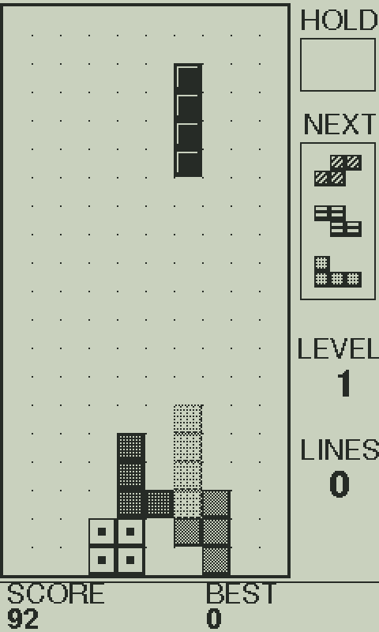

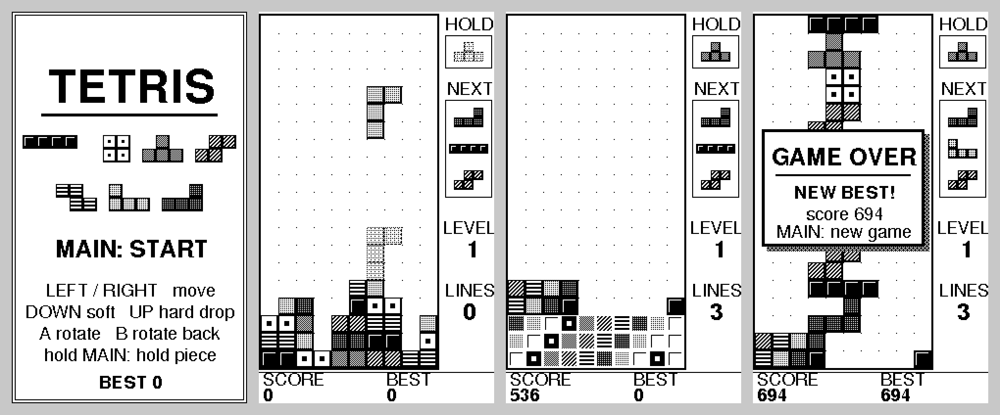

| Key | Function (device button) |
|---|---|
| arrows left / right | move, auto-repeat (D-pad) |
| arrow down / up | soft drop / hard drop (D-pad) |
| X / Z | rotate clockwise / counter-clockwise (A / B) |
| Enter or Esc | MAIN: start, pause, resume; hold it for 0.4 s to swap the hold piece |
| C | hold piece (the same long press of MAIN) |
| Space | hard drop (alternative) |
| R / Q | back to a new game / quit |

The window shows the same native 1-bit frame buffer the panel uses, with a Sharp-LCD tint, at most 30 frames
per second and only when the game reports a new frame. `play tetris --frames 300 --screenshot out.png --keys
"main 10 left a up shot:x.png"` runs headless with scripted keys and saves PNGs (see `firmware/emu/play.cpp`).

## Games: Flight sim

A paragliding simulator (Condor-like, adapted to a 1-bit 240 x 400 screen and a handheld box) on the real terrain of the
map pack. Code: `firmware/src/apps/games/sim/` (pure C++, float, static buffers); step 1 runs on the PC in the box player
and is built into the box image (on the device it says "needs the map pack" until the QSPI reader is wired).

    firmware/emu/build.sh play sim          # the simulator alone (default pack: the Bulgaria pack of the study, else the Sopot fixture)
    firmware/emu/build.sh play box          # the whole box; "Flight sim" is the fifth tile of the home screen
    firmware/emu/build.sh simbench [PACK]   # frame timing on the PC, scaled to the device (see NOTES.md)

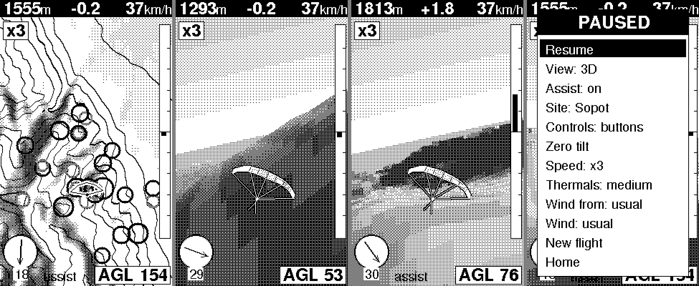

Left to right: the map at launch with the thermal assist on (black rings = cores of 2.5 m/s and more, dithered = weaker; the
ones near the glider are the "house thermals" of the site); the chase camera in a right turn (the glider swings to the left
of the screen and the horizon tilts a third of the bank); the chase camera circling in a thermal; the pause menu.

| Key | Function |
|---|---|
| left / right | bank (ramps to full in 0.33 s, back to level when released) |
| up / down | speed bar (37 -> 52 km/h) / brake (down to 28 km/h; the wing stalls in a turn at that speed) |
| X (A) | toggle map / 3D chase view |
| F | simulation speed x1 / x3 / x5 (default x3; also the pause menu Speed row); a box under the top strip shows it |
| Z or Esc (B / MAIN) | pause menu: Resume, View, Assist (thermals on the map and in 3D), Thermals view columns/bubbles/both, Site (8 takeoffs), Controls Buttons / Tilt, Zero tilt, Speed x1/x3/x5, Thermals, Wind from, Wind speed, New flight, Home |
| T | tilt steering with the mouse: x = roll, y = pitch (top of the window = top of the box away = speed bar); T again = buttons |
| after landing | X = new flight, Z = home |

**Tilt control** (the primary scheme for the device, emulated with the mouse): the box's roll (gravity direction in the
screen plane, like a steering wheel) is the bank: deadzone 3 degrees, expo curve, full at 38 degrees from the zero. Pitch is
the speed bar (top away) or the brakes (top toward you), full at 20 degrees. "Zero tilt" (also shown when Tilt is chosen)
takes the way you hold the box as level: hold it comfortably, press A. In the 3D view the horizon counter-rotates by the box
roll, so it stays level to the real world. The mapping is pure code (`sim/tilt.h`, `TiltMap`) behind an `ITilt` source; the device
gives it roll and pitch from the accelerometer (`sim/accel_tilt.h`).

**One button (the box today: only the board's switch).** The sim steers by tilt (the board's accelerometer, gravity only, through
the case mounting; on only while the sim is open) and every list works like the home screen: short press = next row (wraps),
long press = act on the row. Day screen: Site, Thermals, Wind from, Wind speed, Start, Home. After Start the "ZERO TILT" page
comes before the first flight: hold the box the way you fly, long press = zero and fly. Flying: tilt steers, short = pause menu,
long = map / 3D. Pause menu: short = next row, long = act (Controls re-opens the zero page; Home is the last row). After
landing: short switches "New flight" / "Home", long does it. Holding the switch 3 s still leaves the app. With the D-pad
wired (`KEY_PIN_COUNT > 0`) the sim keeps the keys above instead.

The window title shows frames per second, the longest gap between two frames in the last second, the slowest host tick and
the count of late frames.

**Game mode of the platform.** `IApp::frameIntervalMs()` (default 0 = change-driven, the vario and Tetris) makes `AppHost` run a
fixed-timestep loop: when a frame is due and the panel is ready (`IPanel::ready()`, the previous DMA send is done) the app's
`step(simMs, dtMs)` runs once per elapsed interval (at most 4 when late, the rest counted as dropped), then one frame is
cleared, drawn and presented. `AppHost::stats()` gives fps, the worst gap, steps, frames, dropped; `loopDelayMs()` is 1 ms in
game mode (10 ms otherwise) so the main loop hits the 20 ms frame clock. The simulator asks for 20 ms (a steady 50 fps).

**Physics** (SI units, `glider.*`, `air.*`, `world.*`): polar by table and interpolation (min sink 1.10 m/s at 33 km/h, trim
37 km/h 1.20, full bar 52 km/h 2.20); coordinated turn omega = g tan(bank) / V; extra sink in turns from induced drag
(n^2); roll lag 0.4 s (pendulum), airspeed lag 1.2 s; stall below 26 km/h x sqrt(n) with strong sink and a warning. The air:
wind (grows 40 % per 1000 m), seeded thermals triggered on sun-facing slopes and ridge tops found in the DEM (tilted columns with a
Gaussian core, 2-4.6 m/s on a medium day, 80-200 m radius widening with height, 15-25 min life cycle with overlap, cloud base
2200-2800 m), three always-working "house thermals" per takeoff (trigger spurs below the launch whose bubble drifts over it), ridge
lift = wind . slope with a height decay (it replaces the general sink where it lifts), lee sink, general sink 0.3-0.6 m/s.
At the edge of a thermal the wing tip on the stronger side rises and the glider rolls a few degrees away from it: turn toward the
high wing to centre (the "lift feel", `World::rollKick`). Ground contact is a landing (<= 4.5 m/s on <= 35 degree ground) or a crash.

**3D chase view.** The camera hangs 46 m behind and 20 m above the glider, looking along a smoothed heading (it lags the glider by
0.5 s of sim time, so turns swing the glider across the screen and the world sweeps past); the horizon follows a third of the bank
(with tilt steering it counter-rotates by the box roll as before and the sprite shows the bank relative to it). The glider is a
1-bit sprite from behind (canopy with cells, lines, pilot) in the lower middle of the screen, rolling with the bank and showing
more of the canopy's top when the speed bar is pushed; a shadow appears on the ground when it is within about 60 m below. Code:
`sim/chase.*`.

**Clouds and thermals in 3D** (`sim/sky3d.*`, `Air::columns`). Cumulus clouds are always drawn, as in real flying: one over the top of
each thermal at the cloud base, none while the thermal builds (before a fifth of its life), full from two fifths, thinning from
65 % and gone at 95 %, drifting downwind of the column's top as they age; the size follows the thermal's strength. They are flat-based
1-bit billboards (black outline, white top, grey body, dark base) and are hidden by ridges in front of them (the terrain renderer
keeps a depth buffer per screen column). The nearest four are drawn. With the pause menu's **Assist** on, the 3D view also shows the
thermals, in the style chosen by **Thermals view**: *columns* (a leaning curtain of dashed lines from the trigger to the cloud base,
denser hatching for stronger thermals), *bubbles* (rings rising through the column at a speed proportional to the thermal's strength,
more of them and nearer the core in stronger thermals; the thermal you are in gets larger bubbles around the glider) or *both*
(outline of the curtain and the bubbles). Default: bubbles. The top-down map shows the same thermals as rings.

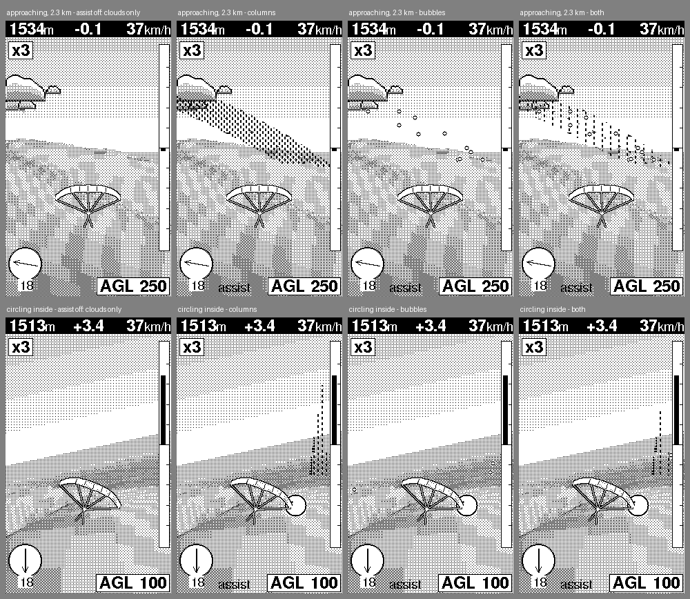

**Day settings.** Starting the sim shows a "TODAY" screen: Site, Thermals (weak / medium / strong / epic), Wind from (the
site's usual or N .. NW), Wind speed (usual 18 km/h, or 0 / 10 / 15 / 20 / 25 / 30 km/h) and Start; up / down pick the row,
left / right (or A) change it, A on Start flies, B goes home. The "usual" wind is the way the takeoff slope faces (taken from the
terrain model) at 5 m/s. Thermals scale the core strength (x0.8 / 1 / 1.25 / 1.5), the share of trigger cells that fire (x0.7 / 1 /
1.15 / 1.25), the cloud base (-350 / 0 / +250 / +450 m) and the general sink (x0.7 / 1 / 1.3 / 1.6) together; medium is the
tuned good day the playability test measures. Ridge lift and lee sink follow the wind, so turning the wind around moves the
lift to the other side of the ridge. The same three rows are in the pause menu: wind changes apply at once and the air eases
into them over about 15 s (0.6 m/s per second, no jump under the glider); Site and Thermals apply at New flight (the row shows a
`*` while it differs from the flight you are in).

**HUD.** Altitude, climb, speed, AGL and the wind arrow as before, plus the flight time (m:ss of the sim clock, so x3 / x5 count faster) and the
straight-line distance from the takeoff (km, one decimal).

**Takeoffs** (approximate, corrected against the terrain model): Sopot, Kalofer, Vratsa, Sliven, Bansko, and the north-eastern plateau
sites Shumen, Madara and Nevsha (launch = steepest convex plateau-edge cell of the terrain model near the rough position).
`build.sh simreach [PACK] [seeds]` prints how many thermals each takeoff can reach and how a scripted pilot climbs. Note that the
coordinates 42.6575 N, 24.7531 E are Sopot town (530 m); the launch is on the slope about 3.7 km north, 1400 m.

## Box: home screen, vario, Tetris, compass tool and Settings in one image

`feather_sense_box` (`main_box.cpp`) holds the home screen (the launcher), the vario, Tetris, the standalone compass and
weather tool (the vario's own compass screen, in a second `App` without tracer or laptop) and the Settings app.
`feather_sense` stays the vario alone, with no game code and no home screen. The box boots straight into the
**start-up app** (default: the vario; Settings picks another, stored in flash). The home screen never opens by itself.

In the box image the vario is an app like the others: it exists in RAM only while it runs (one shared app arena with Tetris,
the compass tool and the flight sim). Leaving it to another app loses its flight state (trail, wind, thermals, map cache);
coming back starts fresh and reconnects the tracer. The radios, settings and the wall clock live on.

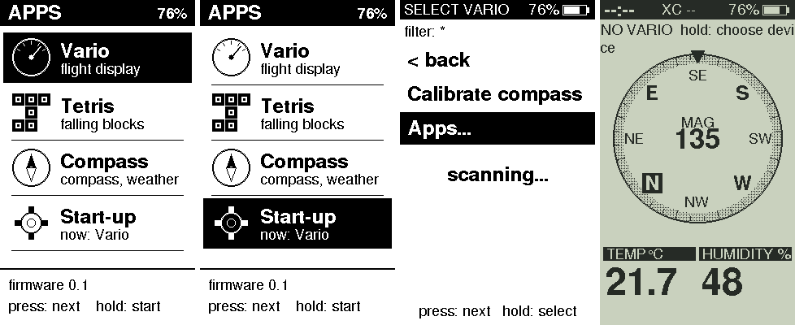

**Start-up animation** (`apps/intro`, box image only). At power-on and on wake from System OFF (not on the way out of the clock sleep)
the box plays a 2.8 s intro at 50 fps before the start-up app: the flight sim's chase camera behind a paraglider thermaling tight
under a cumulus over the real terrain of the map pack, climbing into the cloud, which fills the screen as dithered white with the
box's name dissolving in as the end frame; the white is the hand-over to the start-up app. Any press skips it (the press is used up,
and the 3 s hold only skips); the vario's tracer scan runs in parallel from boot, so the intro is the only delay. Without a pack
(or one that covers no takeoff of the sim) a 2D version plays: contour lines falling away under swelling clouds. The path is scripted
and deterministic. Settings > Intro turns it off. It lives in the shared app arena and is gone before the start-up app is built.
`build.sh play box` shows it at start (`--no-intro` skips it); `emu/out/intro_sheet.png` and `intro_flat_sheet.png` are contact sheets.

**Home screen.** A status bar (local time from the tracer's GPS time once the vario has seen a fix, `--:--` before; map pack
status; box battery), a grid of large tiles (icon and name; the chosen tile is inverted) and a footer with a line about the
chosen app and the key hint. Apps register with a name, a few words, a line of text and an icon (`platform/app_registry.h`,
`platform/gfx/icons.h`), so a new app is one `registry.add(...)` in `main_box.cpp`. Single switch: short press = next
tile, long press (0.7-1.5 s) = open, 3 s hold = power off. Six buttons: arrows move over the grid, A opens.

**Settings** (`apps/settings`, on the platform pieces in `platform/settings/`): Compass (calibration), Board mounting
(index 0..23, long press = +1, or the arrows), Start-up app (long press cycles the apps that may start the box; Settings
and the home screen are not offered), Time zone (long press = +1 h, arrows = 30 min; `ctl.py tz` sets any value),
Intro (long press toggles the start-up animation On / Off, default On),
Power off (long press toggles Clock / Off: what the 3 s hold does, see "The switch"),
About (firmware version, map pack and its area, the pack's Copernicus and OpenStreetMap credits), Home.

**Getting to the home screen** (a deliberate gesture from inside an app, nothing that a flight can trigger by accident):

| Where | Gesture |
|---|---|
| Vario | long press (0.7-1.5 s) for the vario menu, one short press to the **Home** row, long press. The vario's other gestures are unchanged: short = page, 3 s hold = power off. |
| Tetris | pause (short press), then long press (or B) = Home; short press (or A) resumes. Or the 3 s hold. |
| Compass tool | long press for its menu, short press to **Home**, long press. Or the 3 s hold. |
| Settings | the **Home** row, B, or the 3 s hold. |
| Any app, six-button case | hold **A + B** together for 1.5 s (the vario too; `IApp::comboExit()` is the switch, a one-line override turns it off for an app). The front buttons are not wired yet: define `PIN_KEY_UP/DOWN/LEFT/RIGHT/A/B` in `platform/hw/pins.h` (`platform/hw/keymap.h` is the table). |
| Home screen | short press = next tile, long press = open; arrows and A on the six buttons; 3 s hold = power off. |

The 3 s hold was chosen for games because the switch's other gestures are taken (short: page or pause, 0.7-1.5 s: menu
or start, release between 1.5 and 3 s: cancelled) and the hold is the only one that cannot be mistaken for them.

**What leaving the vario does.** The tracer link and scan stop and the compass sensors are switched off (`App::end`,
`ITracer::pause`); coming back restarts the scan (a few seconds until data flows) and the sensors. The flight model
stays, its data simply goes stale. A game does not run, and its code is never touched, until it is chosen. The compass
sensors also run only while the Settings calibration screen is open. The BLE laptop link (advertising and link) is off while a
game runs and comes back when it is left; in the vario, the tools and the home screen it stays up (host drawing only takes the
screen while the vario is active; laptop commands such as `ctl.py cal` are served by the vario, so they work while it runs).

### Box on the PC

    firmware/emu/build.sh play box --igc ~/Downloads/2026-08-16-XCT-SVE-09.igc --start 4185 --speed 6
    firmware/emu/build.sh play box --sim                   # the vario's built-in test flight instead of a file
    firmware/emu/build.sh play tetris                      # Tetris alone, as before

The player (`firmware/emu/play.cpp`, needs SDL2) runs the same `AppHost` as the device over mock ports. The mock tracer
plays an IGC file (converted by `host/make_lines.py`) or a line file (`--lines f.txt`) at `--speed` lines per second
(default 3), only while the vario runs. Other options: `--battery 60`, `--temp 18`, `--scale 3`, `--plain`, `--seed N`.

| Key | Function |
|---|---|
| Enter or Esc | the user switch. Hold it: 0.7-1.5 s is the long press, 3 s the hold; the title shows `MAIN 1.2 s` |
| arrows, X, Z | D-pad, A, B (A + B held 1.5 s = home screen) |
| `,` `.` or mouse wheel | turn the compass heading |
| C, R, Q | Tetris hold piece, restart (reboot the box), quit |

The window title shows the app, frames per second (frames the host actually presented) and the compass heading.
Headless: `play box --igc f.igc --speed 12 --keys "200 shot:a.png main 30 long 20 shot:b.png"` (tokens: `main left
right up down a b` taps, `long` 0.9 s, `off` 3.2 s hold, `combo` A + B, `+key` / `-key`, a number = 30 ms frames,
`turn:90`, `shot:file.png`). `firmware/emu/build.sh smoke` runs a fixed script and checks which app is active at each
screenshot (`emu/out/box_*.png`); `check.sh` runs it.

### Stack check

The loop task has 4 KB (`LOOP_STACK_SZ`). `scripts/stack_check.py` reads the linked ELF of each image (the PlatformIO
GCC 7 has no call-graph output, so frames come from the function prologues and calls from the `bl` instructions) and
prints the deepest call chain from `loop()` and `setup()` and the largest frames; it fails on a frame over 1 KB or a
chain over 3 KB. It cannot see indirect calls it cannot resolve (function pointers, library virtuals), recursion, or
other tasks' stacks (BLE callbacks run on a 3 KB task), so it is a guard, not a proof. Its first run found a 1.8 KB
frame in the wind fit (three `double[64]` locals): the worst chain was 3.5 KB of 4 KB; now 2.6 KB.

## Host tools (`host/`)

| Tool | Use |
|---|---|
| `ctl.py` | control the box: `filter 'XC*'` (scan name filter), `tz 180` (minutes from UTC), `sim on\|off` (built-in test flight), `page compass\|thermal`, `cal start\|save\|cancel`, `orient 0..23` (how the board sits in the case) |
| `igc_replay.py` | replay an IGC file to the box as tracer lines (`--find`, `--start`, `--speed`, `--page`) |
| `make_lines.py` | convert an IGC file or a tracer capture into line files for the emulator |
| `xct_probe.py` | find the tracer over BLE, list its GATT table, log raw notifications (`[seconds] [name]`) |
| `orient_log.py` | record the compass sensor readings from the serial status line (`[seconds] [file]`) |
| `orient_analyze.py` | solve the sensor-to-case axis mapping from that log and print the code to paste (`--selftest`) |
| `wind_check.py` | run the wind estimator offline on an IGC file |
| `dashboard.py`, `send_test.py`, `bench.py`, `display_link.py` frame drawing | legacy: the early design where the laptop draws frames over BLE (`BLIT`/`DATA`/`FLUSH`). The vario screen resumes 10 s after the last draw command. Not needed for normal use. |

`display_link.py` is also the BLE connection helper that `ctl.py` and `igc_replay.py` use.

## Troubleshooting

- **"SharpDisplay not found" after stopping a replay**: the box keeps the stale laptop connection for
  several seconds. Wait about 10 s.
- **Two tracers with the same name**: tell them apart by the address id in the device list; the box
  reconnects by address. Reselect the tracer after a firmware change that alters the stored settings (the
  file is reset then).
- **The tracer accepts one connection**: disconnect phone apps first.
- **Heading is not trustworthy yet when it shows `MAG`** until the board mounting is set: record a session
  with `orient_log.py`, run `orient_analyze.py` on it and send the index it prints with
  `ctl.py orient <index>` (stored in flash; the per-chip axes `toBoardAccel`/`toBoardMag` in
  `firmware/src/platform/hw/compass_lis.cpp` are still identity). `TRK` (GPS track) is not affected.
- **Speed unit**: the tracer's speed is assumed to be km/h; this is unverified until a capture with a
  real GPS fix.
- **Serial status line** (printed every 2 s, only when a terminal is attached):
  - `st`: `ok`/`bad` lines parsed, `fresh`, `fix`, `alt`, `spd`, `vs`, `wind=valid/speed`, `sim`, `link`
    (0 none, 1 searching, 2 connecting, 3 connected), `pg` (0 compass, 1 thermal), `marks`, `trail`, then
    timings in microseconds (`tick` worst loop pass, `refresh` panel transfer, and benchmark values).
  - `dev saved=NAME ADDR t<type> conn=ADDR`: the saved tracer and the one connected now.
  - `raw ...`: the last line received.
  - `cmp`: compass sensors (`on`, `present`, accelerometer, magnetometer, gyro in deg/s, heading, source
    0 none 1 GPS 2 MAG, calibration valid, `orient` mounting index, `fused` 1 when the heading comes from
    the gyro fusion, `bias` the learned gyro bias in deg/s). Accelerometer, magnetometer and gyro are in the
    board frame (before the mounting index is applied).
- Saved settings live in the nRF's flash filesystem: the tracer and its name filter in `/vario.cfg` (vario only), the start-up
  app, high score, time zone, mounting and compass calibration in `/box.cfg` (the box's key store, both images). The first
  start of this firmware copies the calibration, mounting and time zone out of the old files, so a calibration survives the update.
