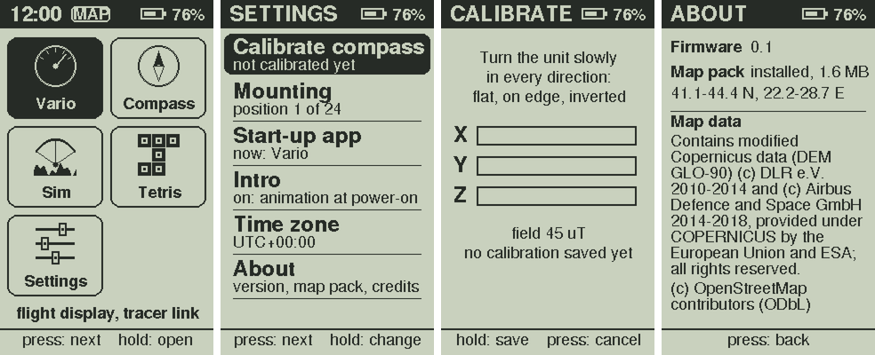
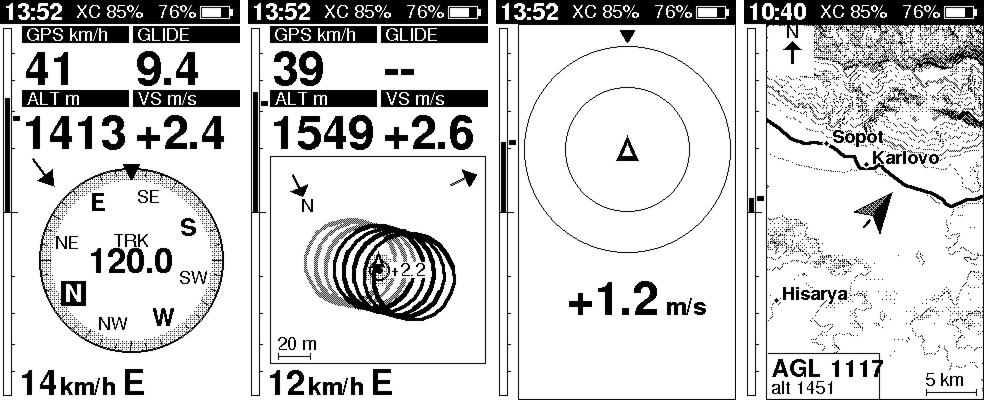
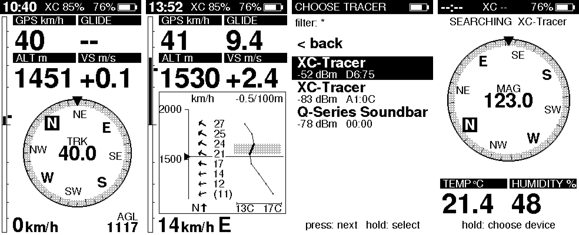
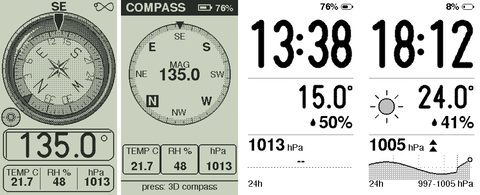
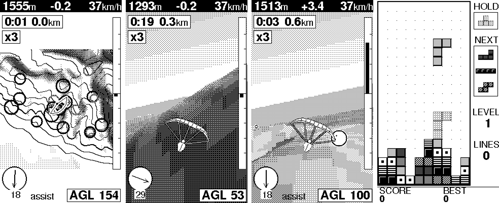
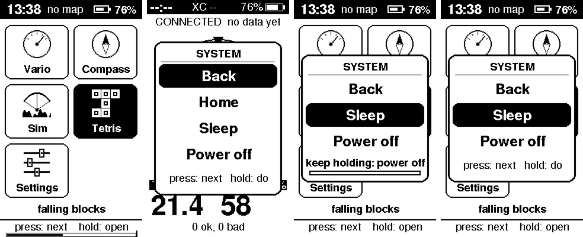

# XC display: a handheld box for an XC Tracer paragliding vario

A handheld, portrait display for an XC Tracer Mini III GPS vario, built on an Adafruit Feather nRF52840 Sense, a 2.7" Sharp memory LCD
(400x240, used as 240x400) and a LiPo, with one user switch (six front buttons in the case, not wired yet). It is a Bluetooth LE central
to the tracer (its `$XCTRC` text lines, about 3 per second) and a BLE peripheral (`SharpDisplay`) for a laptop. One firmware image, the
**box**, holds a home screen and the apps: the flight display, a compass and weather app, a paraglider flight sim, Tetris and Settings. A
clock sleep turns the box into a desk clock and weather station. The code is pure C++ that also builds and runs on the PC (emulator,
tests, a player); a small platform makes new apps easy to add.

- [`docs/PLATFORM.md`](docs/PLATFORM.md): developer guide: how to build another app (frame loop, input, ports, motion service, graphics, tests), with the example app `firmware/src/apps/examples/level/`.
- [`NOTES.md`](NOTES.md): measurements, findings and decisions, in the order they were made (table of contents at the top).
- [`PLAN.md`](PLAN.md): status, what still needs hardware, parked ideas.
- [`docs/MATH.md`](docs/MATH.md): the maths (wind fit, thermal memory, compass, calibration, dithering).
- [`CLAUDE.md`](CLAUDE.md): rules for contributors and AI agents.
- [`case/`](case/README.md): the 3D-printed enclosure (CadQuery model, STL / STEP): screwless, prints without supports in PETG, D-pad + A / B below the screen, velcro back, strap tunnel.

| Front | Back | Inside |
|---|---|---|
|  |  |  |

Images below are rendered by the PC emulator from the same drawing code the device runs (shown at half size; grey tones are an 8x8
ordered dither on the 1-bit panel).

## The apps

Home screen and Settings:

**Home.** A status bar (local time, map pack, battery), a grid of tiles and a footer with the chosen app's line and the key hint. The box
never opens it by itself: it boots into the **start-up app** (default Vario, chosen in Settings) and the home screen is reached only through
the system sheet (see Controls).

**Vario** (flying). Speed, glide ratio, altitude, climb, a heading-up compass dial, wind, and further pages: thermal map, centring cue,
and with a map pack AGL and a north-up map. Short press switches page; a long press opens the tracer list.

**Compass** (& weather, no tracer). Opens on a 3D compass: a card in a glass dome that stays level while the box tilts, with the exact
heading, a bubble level, temperature, humidity and pressure. A short press swaps to the flat heading-up dial with the weather strip.
Calibration and mounting are in Settings. The sensors run only while the app is open.

**Sim.** A paraglider simulator on the real terrain of the map pack (needs the pack): top-down map and 3D chase view, thermals from
sun-facing slopes, ridge lift, clouds, eight takeoffs, day settings (thermals, wind), time x1 / x3 / x5. The box steers it by tilt
(roll = bank, pitch = speed bar; "Zero tilt" takes the way you hold the box as level). With the switch alone: short press = next row,
long press = act; flying: tilt steers, short = pause menu, long = map / 3D. With the D-pad (when wired): left / right bank, up / down
speed bar and brake, A = map / 3D, B = pause menu.

**Map** (topo + GPS, needs the map pack). Hillshade, contours, main roads and towns of the pack, 25 to 400 m per pixel, north up or
**Compass** (turned so the direction the box points is up; the compass sensors run only then). With the tracer connected it follows the
GPS and shows the pilot arrow; without it, it is a plain map to browse (it opens over Sopot). Switch: short = zoom in (from the closest it
wraps to the widest), long = North up / Compass. Six buttons: D-pad pans (the map stops following; a cross marks the centre), A / B zoom
in / out, hold A = back to the GPS, hold B = North up / Compass. The picture is drawn in 64 px tiles, nearest the screen first, so a pan
only waits for the strip it uncovers (a sparse dot grid marks a tile still being drawn).

**Tetris.** Switch alone: short = pause menu / next, long = act. D-pad: arrows move and drop, A / B rotate, MAIN starts and pauses,
long MAIN holds a piece.

**Settings.** Calibrate compass, Mounting (board position 1..24 in the case), Start-up app, Intro (the 4.5 s start-up animation on / off),
Time zone, About (firmware version, map pack and its area, the pack's Copernicus and OpenStreetMap credits). Long press changes a row.

**Level** (example, not in the shipped images): a bubble level from the tilt sensor, the template of `docs/PLATFORM.md`. Build it with
`scripts/flash.sh feather_sense_box_examples`.

`feather_sense` is the vario alone, with no home screen, games or system sheet.

## Controls

Every screen works with the switch alone and with the six buttons alone; both are always live, and hints name whichever was used last.

| Gesture | Switch | Six buttons |
|---|---|---|
| move / next | short press (under 0.7 s) | UP / DOWN (LEFT / RIGHT) |
| do / select | long press (0.7 to 1.5 s, then release) | A |
| back / cancel | (use the system sheet) | B |
| system sheet | hold 3 s | A + B held 1.5 s |
| power off (System OFF) | hold 6 s | choose Power off in the sheet |

A release between 1.5 s and 3 s does nothing. A thin **hold bar** along the bottom edge fills from 0.7 s toward 3 s while the switch is down
(a cue only: releasing early is the normal press, long press or cancel). At 3 s the **system sheet** opens over any app: Back, Home (not
in the home screen), Sleep, Power off. Press = next row, long press = do it; buttons: UP / DOWN, A, B = Back. Keep holding the switch and a
second bar fills inside the sheet; at 6 s the box goes to System OFF. The sheet closes by itself after 6 s without input. While it is open
the vario keeps receiving data, and Tetris and the sim pause. The start-up animation is the exception: any press skips it. The sheet is the
only way to the home screen, so nothing a flight can trigger by accident leaves the vario.

Power on from System OFF, and wake from the clock sleep: hold the switch about 1 s (a shorter press does not wake it, so it cannot happen in
a pocket). The vario-only image has no sheet: a 3 s hold shows "Keep holding to power off" and powers off.

In the vario, a six-button DOWN / RIGHT is a short press, A a long press, B "< back". Settings and the home screen use short = next row,
long = act.

## Clock sleep and weather station

Sleep (system sheet) stops the tracer link, the laptop link, the compass and the map flash and shows the local time (big), the battery,
temperature and humidity, the pressure with its 3 h tendency arrow, a rough barometer forecast pictogram (sun, sun and cloud, cloud, rain,
storm) and a 24 h pressure chart (the last two images above). The pressure is sampled every 10 min (also while the box is awake and
flying); the screen is redrawn once a minute. Unknown values read `--`, never a guess. Holding the switch 1 s wakes the box into the
start-up app (with the intro); the clock stays valid. A nearly empty battery drops the sleep into System OFF.

What survives what (the pressure history and the clock are kept in a retained RAM page):

| Event | History | Clock |
|---|---|---|
| reset, USB `REBOOT` | kept | kept |
| System OFF (6 s hold) and wake | kept | unknown until a GPS fix or the PC sets it; the time asleep shows as a gap |
| flashing over USB | lost | unknown |
| battery removed | lost | unknown |

The time is the tracer's GPS time carried on by the box's own crystal; without a time it shows `--:--`. A time stays valid for 30 days.
System OFF retention is designed and tested in the emulator but not yet confirmed on the board (PLAN.md).

### Setting the clock

    python host/settime.py [--port /dev/cu.usbmodemXXXX]     # sends this computer's UTC time and UTC offset

`host/load_pack.py` and `host/logdl.py` send the same `TIME <utc epoch> <minutes east of UTC>` line when they connect. The box sets its clock
and time zone from it (Settings > Time zone is overwritten); `TIME?` answers `tm now HH:MM`. A GPS fix always overrides it. Set the clock
after flashing.

## Flashing

Needs a Python venv at `.venv` in the repository root with PlatformIO, pyserial, bleak and pillow (in a git worktree, symlink the main
checkout's `.venv`).

    scripts/flash.sh feather_sense_box     # the box (default is feather_sense, the vario alone)
    scripts/flash.sh feather_sense_diag    # diagnostics build: profiler (`prof`) and benchmark (`bench`) lines

`flash.sh` checks that no program holds the serial port, retries, and only succeeds on "Device programmed.". Never leave a serial monitor
running while flashing: the bootloader uses the same USB port. Serial is USB CDC at 115200 (`/dev/cu.usbmodem*`).

## Building and testing

    scripts/check.sh                   # emulator build + all tests (sanitizers on), box smoke run, device builds, stack and RAM checks
    scripts/install-hooks.sh           # git pre-commit hook that runs check.sh
    cd firmware && ../.venv/bin/pio run          # device images only
    firmware/emu/build.sh              # emulator: tests, then screen renders in firmware/emu/out/*.png
    firmware/emu/build.sh smoke        # headless scripted run of the whole box, screenshots out/box_*.png

`check.sh` exits non-zero if a test fails, the smoke run fails, a build fails, the stack check finds a frame over 1 KB or a call chain over
3 KB (`scripts/stack_check.py`), or the box heap falls below 48 KB (`scripts/ram_check.py`). Replay a recorded flight through the whole vario app:

    python host/make_lines.py igc flight.igc --start 4185 --seconds 900 > flight.txt
    firmware/emu/build.sh replay flight.txt outdir --hz 3 --shot-every 20      # also --inject, --mix FILE, --thermal, --press, --rot

`replay` prints a behaviour digest (a hash of every present() time and frame): two builds with the same digest drew the same pictures at the
same times. Never commit IGC files or other logs: the repository is public. The smoke script uses an IGC file from `~/Downloads` if one is
there; set `SMOKE_IGC=/nonexistent` to use the built-in test flight.

### The box on the PC

    firmware/emu/build.sh play box --igc flight.igc --start 4185 --speed 6     # needs SDL2 (brew install sdl2)
    firmware/emu/build.sh play box --sim                                       # the vario's built-in test flight
    firmware/emu/build.sh play tetris | sim                                    # one app alone

The player (`firmware/emu/play.cpp`) runs the same `AppHost` as the device over mock ports. Options: `--pack FILE` (default
`maps/bulgaria.pack`), `--no-intro`, `--battery 60`, `--temp 18`, `--scale 3`, `--plain`, `--seed N`.

| Key | Function |
|---|---|
| Enter or Esc | the switch: hold for long press / hold; the title shows `MAIN 1.2 s` |
| arrows, X, Z | D-pad, A, B (A + B held 1.5 s = system sheet) |
| `,` `.` or mouse wheel | turn the compass heading |
| arrows, `0`, `T` (Compass) | tilt the virtual box (`0` = level); `T` = the mouse tilts it |
| C, R, Q | Tetris hold piece, restart (reboot the box), quit |

Headless: `play box --keys "200 shot:a.png main 30 long 20 shot:b.png"` (tokens: `main left right up down a b`, `long`, `off` = 3.2 s hold,
`sheet:home|back|sleep|off`, `combo`, `+key` / `-key`, a number = 30 ms frames, `turn:90`, `tilt:30,-10`, `shot:file.png`).

## Map pack (terrain)

With a map pack (`host/terrain/mkmappack.py`, format in `host/terrain/FORMAT.md`; Bulgaria is 1.72 MB: Copernicus GLO-90 heights
on a 200 m grid, towns and main roads from OpenStreetMap) the vario shows **AGL** (bottom right of every page; the GNSS altitude of
the tracer minus the terrain model under the fix, `--` without a fix or outside the pack) and a **map page** after the thermal page.
AGL comes from a model: typically +-10 m, up to 80 m at single peaks and gorges, and it includes trees and buildings (a surface
model). It is not the baro altitude. The map page is north-up at 100 m/px (22 x 38 km), sun-lit hillshade (sun from the south-west),
dotted contours (every 200 m, every 5th bolder), main roads (solid, no railways), towns (Latin names), the track of the last 20
minutes and the pilot arrow (a paper plane). The picture is built in small slices between loop passes, so the vario never stalls on it.
The attribution (Map (c) OpenStreetMap contributors (ODbL), Copernicus DEM (c) DLR / Airbus, provided under COPERNICUS by the EU and
ESA) is shown once per boot as a banner and always under Settings > About. Without a pack nothing changes.

**Loading the map into the box** (one command; the pack lives in the board's own 2 MB QSPI flash, so loading never touches the
firmware or the saved settings). Needs an image with the loader (`feather_sense`, `feather_sense_diag`, `feather_sense_box`), the box
connected by USB:

    .venv/bin/python host/load_pack.py maps/bulgaria.pack          # finds the box, erases, streams, checks, restarts it
    .venv/bin/python host/load_pack.py --status               # what the box holds now (header, whole-pack CRC)

The box shows no map while it loads; the header that makes the pack valid is written last, after the box has checked the CRC of
the bytes it stored, so an interrupted load leaves "no pack", never half a pack. With a terminal attached the box prints a
`pack ...` status line (header, length, CRC check, flash id, read speed, whether the terrain code opened it).
On the PC: `firmware/emu/build.sh play box --igc f.igc --pack maps/bulgaria.pack` (default: maps/bulgaria.pack if present, else the Sopot test fixture);
`firmware/emu/build.sh loadtest [pack]` runs the loader script against the firmware's loader code over an in-memory flash.

## Vario details

### Flight screen

The header shows local time, the tracer battery (`XC 46%`), `SIM` while the simulator runs, and the box's
own battery. Time needs the time zone set once (`ctl.py tz`, minutes from UTC).

The pages share the top part: a thin vertical vario strip along the left edge (instant climb filled from
the centre, a small block marks the average), and four cells: `GPS km/h`, `GLIDE`, `ALT m`, `VS m/s`. The
last line is the wind: speed, `km/h`, and the direction it comes from (for example `14 km/h E`), with
`old` when the estimate is more than 5 minutes old and `0 km/h` when there is none yet.

**Compass page** (default). A heading-up dial with the pointer at the top, N/E/S/W and NE/SE/SW/NW on the
ring, ticks every 10 degrees, and the heading as the big number in the middle. A small label above it
says where the heading comes from: `TRK` is the GPS track (used above about 4 km/h, released below 2.5),
`MAG` is the magnetic compass (used otherwise). With neither, the dial stays north-up and shows `--`.
A wind arrow sits in the corner of the dial the wind comes from and points the way it blows, relative to
the heading. It is drawn only when the heading is the GPS track and a wind estimate exists.

**Thermal page.** A heading-up map replaces the dial; you are the arrow in the centre. It shows the last
3 minutes of track in the air-mass frame (shifted by the wind drift, so a thermal holds still while you
circle). The last 90 s is solid, thicker where you climbed faster; older track is dashed. Up to 6
remembered thermals appear as rings with their average climb; a thermal is remembered after at least 8
points of 0.5 m/s or more adding up to 15 m of climb (the circling part sets its centre), drifts with the wind and expires after 15 minutes. When the newest thermal
is off the map an arrow badge at the frame edge points to it with the distance. The map has a north
marker (top-left), a wind arrow (top-right) and a scale bar. The map moves continuously between the tracer's
samples (shown about 0.4 s behind the newest one, interpolated, never extrapolated), and the zoom glides
between its fixed steps. It reads `no GPS track` until there is a
track.

Wind comes from a circle fit over about the last 30 s of ground velocity while turning. It needs about
200 degrees of turn and a fitted airspeed of 14 to 72 km/h, so it appears after the first full circle.

### Status screen, `NO FIX` and `--`

- No fresh data (nothing for 3 s) replaces the flight screen with a status screen: `SEARCHING`,
  `CONNECTING`, `CONNECTED` (then "waiting for data..." and a count of good and bad lines) or `NO VARIO`,
  with the saved device name or the scan filter.
- The tracer reports latitude and longitude 0 when it has no GPS fix. Then the speed cell is titled
  `NO FIX` and speed shows 0, and the heading comes from the magnetometer.
- `--` means a value that is not a finite number or not available (glide ratio when not sinking, no
  heading, no time).

### Vario menu

A long press on the flight screen (six buttons: A) opens the tracer list: press moves down (it wraps), long press connects to the row and
saves it; `< back` closes. Devices are sorted by signal; the two letters-and-digits are the last two bytes of the address, which tell apart
tracers with the same name. The saved tracer survives power off; at boot the box reconnects by address. The list holds only flying things.

### Compass calibration

In the box: Settings > Calibrate compass. Turn the box slowly through every direction (flat, on edge, inverted) until the X, Y and Z bars
fill (about 70 uT each); long press or A saves, short press or B cancels. The vario-only image has no on-device row: use
`ctl.py cal start|save|cancel` (also works in the box while the vario runs). Calibration (hard-iron sphere fit), mounting and time zone are
in the box's flash store (`platform/settings/box_settings.h`). The magnetic heading is magnetic north; there is no declination correction.

## USB bench commands (box image)

Over the USB serial port (115200), for a PC on the cable; no BLE path or menu does these:

| Command | Does |
|---|---|
| `APP <name>` / `APP?` | open an app by name (launcher, vario, compass, tetris, settings, sim) through the normal switch path; print the active one |
| `TIME <epoch> <tz min>` / `TIME?` | set / read the clock |
| `REBOOT` | save the retained page and soft-reset |
| `LOG...` | flight log commands (`host/logdl.py`) |

With a terminal attached the box prints status lines: `st` (data, timing), `dev`, `raw`, `cmp` (compass sensors; `rec=N` counts bus
recoveries), `wth` (pressure, temperatures, humidity, battery, `log=` samples in the history, `ret=` none / ok / crc: what the retained
page gave at boot), `pwr` (the last run's event ring: switch events, app switches, sheet acts, power entries) and `gm` (fps and timing
while a game runs). Read the port for a fixed number of seconds and close it.

## Flight log and the gyro dead-reckoning test

While the vario app is open and the tracer is sending, the box records every parsed tracer line (receive time, the line's own
time, position, speed, course, vario) and the **turn rate about the vertical** from the gyro (25 Hz, clockwise positive, via
the AHRS gravity vector, so the mounting does not matter). It goes to the last 256 kB of the QSPI flash; the map pack gets the
rest (a pack can be at most 1.82 MB; the loader refuses a larger one). Nothing is recorded in the other apps, and the screen is
unchanged. Capacity: about 100 bytes/s, 360 kB/hour, so **about 40 minutes**; when full it stops (it never overwrites). The
internal flash filesystem (28 kB) would hold only 3 minutes, which is why the QSPI tail is used. Format: `firmware/src/apps/vario/core/flight_log.h`.

**Ground test (walk, cycle or drive circles):**

1. Flash the box image (`scripts/flash.sh feather_sense_box`; the vario image `feather_sense` has the log too). One-time, with
   the box on USB: `python host/logdl.py --erase` formats the log (a few seconds; the map is blank meanwhile).
2. Switch on the tracer and the box, wait for a GPS fix on the box (vario app open, data shown). Carry both as in flight: box
   on the chest / riser / in a cockpit mount, screen towards you; the tracer where it is normally.
3. In an open area walk or cycle (or drive slowly, with the box fixed in the car) **circles of 10 to 30 m radius for 2 to
   3 minutes, in both directions**, changing the turn rate now and then (tight, then wide), with straight stretches in between;
   about 10 minutes in total. The change of turn rate matters: with a constant turn rate the delay cannot be measured. Keep
   the box in the vario app the whole time.
4. Connect the box with USB (nothing else may use the port) and run

       python host/logdl.py logs/walk1          # writes logs/walk1.bin and CSVs; add --erase to clear the log afterwards
       firmware/emu/build.sh logeval logs/walk1.bin            # --latency MS to force a delay, --wind to add a drift wind

   `logeval` reports the fix rate, the measured delay between the gyro turn and the GPS course (rx time minus the instant the
   fix describes), and the course / position error of "hold the last fix" against dead reckoning (the same code as
   `apps/vario/core/deadreckon.*`), overall and while turning faster than 8 deg/s. `python host/logdl.py --info` shows the state
   (`used`, `cap`, `dropped`). A real flight does the same; the log holds the first 40 minutes after the erase.

## Laptop tools (`host/`)

| Tool | Use |
|---|---|
| `ctl.py` | control the box: `filter 'XC*'` (scan name filter), `tz 180` (minutes from UTC), `sim on\|off` (built-in test flight), `page compass\|thermal`, `cal start\|save\|cancel`, `orient 0..23` (how the board sits in the case) |
| `igc_replay.py` | replay an IGC file to the box as tracer lines (`--find`, `--start`, `--speed`, `--page`) |
| `make_lines.py` | convert an IGC file or a tracer capture into line files for the emulator |
| `xct_probe.py` | find the tracer over BLE, list its GATT table, log raw notifications (`[seconds] [name]`) |
| `orient_log.py` | record the compass sensor readings from the serial status line (`[seconds] [file]`) |
| `orient_analyze.py` | solve the sensor-to-case axis mapping from that log and print the code to paste (`--selftest`) |
| `logdl.py` | download / erase the flight log over USB, convert to CSV (`--info`, `--erase`, `--decode`); see "Flight log" |
| `wind_check.py` | run the wind estimator offline on an IGC file |
| `dashboard.py`, `send_test.py`, `bench.py`, `display_link.py` frame drawing | legacy: the early design where the laptop draws frames over BLE (`BLIT`/`DATA`/`FLUSH`). The vario screen resumes 10 s after the last draw command. Not needed for normal use. |

`display_link.py` is also the BLE connection helper that `ctl.py` and `igc_replay.py` use.

## Hardware and wiring (as built)

| Display pin | Feather pad | Arduino pin | nRF GPIO |
|---|---|---|---|
| CLK | SCK | 26 | P0.14 |
| DI (MOSI) | MO | 25 | P0.13 |
| CS (active high) | RX | 1 | P0.24 |
| EXTCOMIN | not wired (the MI pad is free) | | |
| DISP, EXTMODE | not wired (breakout defaults) | | |
| VIN, GND | power pins (which supply: not recorded) | | |
| User switch | on board | 7 (`PIN_BUTTON1`) | P1.02, active low |

- Display: Adafruit SHARP Memory Display breakout, 2.7" 400x240 monochrome (product 4694), used in
  portrait. Pins are defined only in `firmware/src/platform/hw/pins.h`. `DISPLAY_ROTATION` is 1; 3 flips the picture
  180 degrees (to be confirmed once the box is mounted).
- Only SCLK, MOSI, CS and power go to the display (checked 2026-10-23). DISP, EXTMODE and EXTCOMIN are left on the breakout's
  defaults; the display works, so the picture is on and VCOM follows the SPI bit.
- VCOM is the bit in each SPI command: every frame flips it, and on a still screen the loop sends a 2-byte VCOM command once a second (`SharpPanel::keepVcom`).
- Only the user switch is wired. The case has six front buttons (D-pad + A / B, 6 GPIO + GND): define `PIN_KEY_UP/DOWN/LEFT/RIGHT/A/B` in `pins.h` (`platform/hw/keymap.h` is the table) to switch them on.
- On-board sensors: I2C 0x1C LIS3MDL magnetometer, 0x6A LSM6DS33 accelerometer and gyro (compass and tilt, through `MotionService`), 0x44 SHT30 (temperature, humidity), 0x77 BMP280 (pressure).

## Troubleshooting

- **"SharpDisplay not found" after stopping a replay**: the box keeps the stale laptop connection for
  several seconds. Wait about 10 s.
- **Two tracers with the same name**: tell them apart by the address id in the device list; the box
  reconnects by address. Reselect the tracer after a firmware change that alters the stored settings (the
  file is reset then).
- **The tracer accepts one connection**: disconnect phone apps first.
- **Heading is not trustworthy yet when it shows `MAG`** until the board mounting is set: record a session
  with `orient_log.py`, run `orient_analyze.py` on it and send the index it prints with
  `ctl.py orient <index>` (stored in flash; the per-chip axes `toBoardAccel`/`toBoardMag` in
  `firmware/src/platform/hw/compass_lis.cpp` are still identity). `TRK` (GPS track) is not affected.
- **Speed unit**: the tracer's speed is assumed to be km/h; this is unverified until a capture with a
  real GPS fix.
- **Serial status line** (printed every 2 s, only when a terminal is attached):
  - `st`: `ok`/`bad` lines parsed, `fresh`, `fix`, `alt`, `spd`, `vs`, `wind=valid/speed`, `sim`, `link`
    (0 none, 1 searching, 2 connecting, 3 connected), `pg` (0 compass, 1 thermal), `marks`, `trail`, then
    timings in microseconds (`tick` worst loop pass, `refresh` panel transfer, and benchmark values).
  - `dev saved=NAME ADDR t<type> conn=ADDR`: the saved tracer and the one connected now.
  - `raw ...`: the last line received.
  - `cmp`: compass sensors (`on`, `present`, accelerometer, magnetometer, gyro in deg/s, heading, source
    0 none 1 GPS 2 MAG, calibration valid, `orient` mounting index, `fused` 1 when the heading comes from
    the gyro fusion, `bias` the learned gyro bias in deg/s). Accelerometer, magnetometer and gyro are in the
    board frame (before the mounting index is applied).
- Saved settings live in the nRF's flash filesystem: the tracer and its name filter in `/vario.cfg` (vario only), the start-up
  app, high score, time zone, mounting and compass calibration in `/box.cfg` (the box's key store, both images). The first
  start of this firmware copies the calibration, mounting and time zone out of the old files, so a calibration survives the update.
