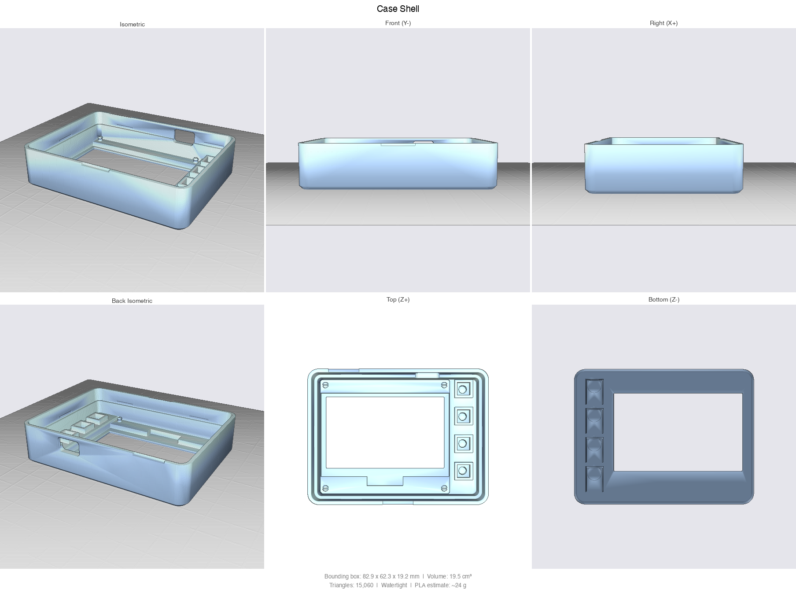
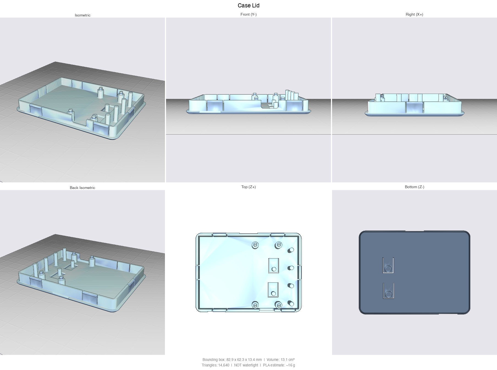
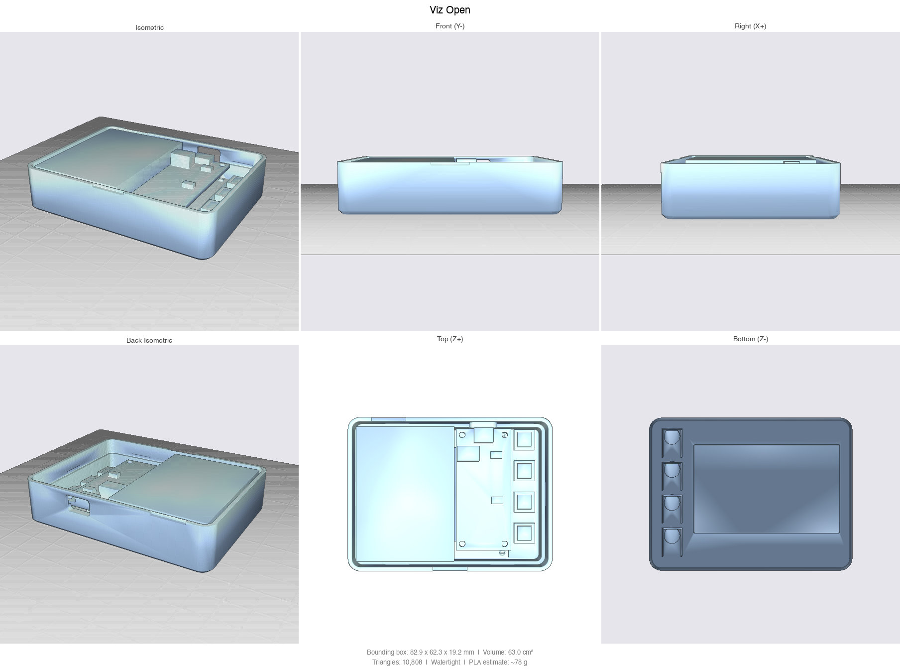

# Enclosure

A two-part, screwless 3D-printed case for the display box: Sharp 2.7" memory LCD breakout (Adafruit
4694), Feather nRF52840 Sense (Adafruit 4516) and a 55 x 40 x 10 mm LiPo.

| Shell | Lid | Opened |
|---|---|---|
|  |  |  |

**Status:** shape and features done; not printed yet. See `NOTES.md` for the assumptions that still
need a caliper (glass height, switch type) before the first print.

## The design

- Outer size 82.9 x 62.3 x 21.2 mm, 3 mm walls, rounded corners, chamfered front and back edges.
- Shell (printed front face down) and lid (printed outer face down), joined by 6 snap tabs with two pry
  notches at the seam. No screws.
- The display PCB and the Feather snap onto split pegs through their mounting holes.
- Display window 59.4 x 35.9 mm, glass recessed 1.2 mm behind the bezel.
- Printed flexure tongues press the Feather's reset and user switches (and four optional front tact
  switches, not wired in the current firmware).
- USB opening in the top wall.

## Files

| File | What |
|---|---|
| `case.py` | the CadQuery model, all dimensions in its PARAMETERS section; source of truth |
| `fitcheck.py` | interference check against stand-in parts, cutaway previews |
| `case_shell.stl`, `case_lid.stl` | the parts to print |
| `case_shell.step`, `case_lid.step` | the same as STEP for other CAD tools |
| `case_assembly.stl`, `viz_*.stl` | assembled and cutaway views (not for printing) |
| `*.png` | preview renders |
| `NOTES.md` | hardware dimensions and their sources, assumptions to verify, print plan, TODO |

## Regenerate

    python -m venv .venv && .venv/bin/pip install -r requirements.txt
    .venv/bin/python case.py        # writes the STL and STEP files
    .venv/bin/python fitcheck.py    # interference check

## Printing (draft)

PETG, 0.2 mm layers, 0.4 mm nozzle, 3 or more walls on the tongues and tabs, about 15 % gyroid, no
supports. Slow down for the thin flexures.
